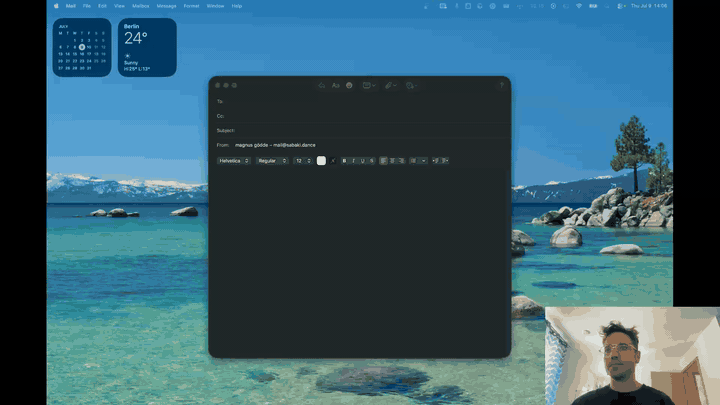

# WhisperShortcut

**Voice-first AI for your Mac.** Press a shortcut anywhere, speak, and the text appears at your cursor. Speak an instruction to rewrite what you selected, have text read aloud, record and summarize meetings, or ask an AI chat that knows your calendar and mail.

Bring your own API key (GPT, Gemini, Grok, Claude, OpenRouter or your own server) or run entirely on your Mac with no key at all. No account, no subscription, no backend of ours. Open source under AGPL-3.0.

[](https://github.com/mgsgde/whisper-shortcut/releases/latest)
[](#download)
[](LICENSE)



▶️ [Watch the full demo on YouTube](https://youtu.be/gc1s0okfHbU) · [whispershortcut.com](https://whispershortcut.com) · [User Guide](docs/guide.md) · Made by [Magnus Gödde](https://magnus-goedde.de)

## Download

| | |
|---|---|
| **[⬇️ Signed `.dmg` from GitHub Releases](https://github.com/mgsgde/whisper-shortcut/releases/latest)** (recommended) | Open it and drag WhisperShortcut to Applications. The full app: text is pasted at the cursor, the 🌐 Fn key starts dictation, Dictate Live, update notices. |
| **Homebrew** | `brew tap mgsgde/tap && brew trust mgsgde/tap && brew install --cask whisper-shortcut` installs the same signed build. |
| **[Mac App Store](https://apps.apple.com/us/app/whispershortcuts/id6749648401)** (free) | Sandboxed: results go to the clipboard instead of being pasted, and a few features need right-click → Services. |

The welcome tour on first launch walks you through permissions, picking a provider key or the offline path, and a first dictation.

## What it does

**Dictation**
- **Dictate**: speak, and the transcription is pasted at the cursor and copied to the clipboard. Names and jargon go in a Glossary so they come out right. Settings → Dictate offers one-click starter lists of German specialist terms (orthopedics, psychiatry/psychotherapy, expert reports).
- **Dictate Live**: text appears at the cursor after every short pause while you keep talking (on-device, Apple silicon).
- **Offline dictation**: [Parakeet Ultra](https://huggingface.co/moondream/parakeet-ultra) transcribes 25 European languages on your Mac in a fraction of a second; Whisper covers the rest.

**Writing with your voice**
- **Dictate Prompt**: select text and say "make this shorter" or "translate to English". With nothing selected, it writes what you ask for, in your own writing style if you turn that on.
- **Templates**: dictate into a fixed format you set up once, such as a clinical note with Anamnese, Befund and Therapie.
- **Read Aloud**: select any text and hear it, with cloud voices or on-device ones, from a small player with pause, skip and speed.
- **Read Aloud Prompt**: select text and say what you want to hear, such as "summarize this in two sentences" or "read it in English". The answer is read aloud instead of pasted. With nothing selected, it reads out the answer to your question.

**Chat and meetings**
- **Chat**: a chat window (⌥Space) with every supported model, screenshots, files, web search and YouTube videos. It works with Google Calendar, Tasks and Gmail, Trello, IMAP mailboxes and folders you share, including your `AGENTS.md` / `CLAUDE.md` context files.
- **Live Meeting**: records your meeting (with headphones too), transcribes it as it goes, writes live notes into the chat and answers questions about anything said so far.
- **Claude, Claude Code and Codex over MCP**: connect them with one click. They read your meetings, even the one running right now, and tune your dictation from your logs, one glossary term or rule at a time that you approve. Examples at [whispershortcut.com/mcp](https://whispershortcut.com/mcp).

**Privacy**
- **Offline Mode**: one switch that keeps everything on your Mac. Dictation, Dictate Prompt, Chat and Read Aloud run on-device, network requests the app builds are blocked, and nothing is written to the usage log. Built for regulated dictation such as patient findings.
- Keys live in your Keychain, data in the app's folder on your Mac. Usage statistics are opt-in and never contain text or audio. Details in [privacy.md](privacy.md).

Every feature, setting and model is described in the **[User Guide](docs/guide.md)**.

## Your own instructions

Dictate and Dictate Prompt have built-in instructions that always apply, because they define how the mode works: Dictate writes down what you said, Dictate Prompt applies what you say to the selected text, or writes it as finished text when nothing is selected. In Settings you add **additional instructions** on top, for you or for an AI app that tunes WhisperShortcut over MCP:

- **Belongs there**: who you are and your field ("I work in hospital IT"), tone per app ("Teams messages short and informal"), spelling and list style ("no em dashes").
- **Does not belong there**: a whole prompt. Don't start with "You are…" or "Your task…", and don't paste a dictation prompt into Dictate Prompt. The mode stays the same; only the result changes.
- **Single names and terms** go in the Glossary.
- **A different output format** for one job, such as a clinical note, goes in a Template. A template replaces the instructions for that one recording.

Settings, Chat and connected AI apps show a warning when the additions read like a whole prompt. Full prompts from earlier versions that replace the built-in instructions keep working and show a button to convert them.

## Shortcuts

| Action | Default shortcut |
| --- | --- |
| Dictate | ⌃⌥1 |
| Dictate Prompt | ⌃⌥2 |
| Template | not set (Settings → Templates) |
| Screenshot | ⌃⌥3 |
| Read Aloud | ⌃⌥4 |
| Read Aloud Prompt | ⌃⌥⇧4 |
| Chat | ⌥Space |
| Settings | ⌃⌥0 |

All of them can be changed in Settings → General; F1–F20 can be bound without a modifier, for a keyboard with a dictation key. In the direct-download build, pressing 🌐 Fn once starts dictation and pressing it again stops. Installs from before these defaults keep ⌘1–⌘4 and ⌘0. Dictate Live and Add Selection to Glossary have no default shortcut.

## Models and keys

| Provider | Used for |
|---|---|
| None (on-device) | Parakeet Ultra and Whisper dictation; Dictate Prompt and Chat on MLX models (Qwen3, Gemma); macOS and Qwen3 voices |
| OpenAI | GPT Transcribe (the default dictation model), GPT chat, Dictate Prompt, Read Aloud |
| Google Gemini | Dictation, Dictate Prompt, Chat, Read Aloud, meetings, YouTube videos |
| xAI | Grok Speech-to-Text, Grok chat with X search, Grok voices |
| Anthropic | Claude chat |
| OpenRouter | Any audio or chat model there; connect in one click, no key to copy |
| Your own server | Any OpenAI-compatible endpoint: LiteLLM, Azure OpenAI, Vertex AI |
| ChatGPT plan | Chat on your ChatGPT subscription, no API key (direct download) |

Which dictation model to pick, with measured latency and cost: [User Guide → Dictation](docs/guide.md#dictation).

## Build from source

```bash
git clone https://github.com/mgsgde/whisper-shortcut.git
cd whisper-shortcut
bash install.sh
```

For development, `bash scripts/rebuild-and-restart.sh` builds Debug and restarts the app.

- **Metal Toolchain**: mlx-swift compiles Metal shaders, so Xcode needs the Metal Toolchain component (about 690 MB). Without it the build fails early with `cannot execute tool 'metal'`. Install it once with `xcodebuild -downloadComponent MetalToolchain`.
- **Package plugin validation**: mlx-swift ships a build plugin, so a plain `xcodebuild` needs `-skipPackagePluginValidation`. The scripts already pass it.
- **Tests need macOS 26.5**: the test target's deployment target is macOS 26.5, while the app runs on 15.5 and later. On an older macOS, `xcodebuild build` works but `scripts/run-tests.sh` does not.
- Requires Xcode 16.0 or later.

Useful scripts: `scripts/logs.sh` (filter app logs), `scripts/run-tests.sh`, `scripts/create-release.sh`, and `scripts/test-{gemini,grok,openai}-models.sh` to check provider model availability.

### Project structure

- `WhisperShortcut/`: Swift source. Start with `AppState.swift` (state machine), `MenuBarController.swift` (orchestrator), `SpeechService.swift` (Dictate, Dictate Prompt, Read Aloud), `ChatView.swift` and `ChatTools.swift` (Chat and its tools), `TranscriptionModels.swift`, `Settings/`.
- `WhisperShortcut/Docs/`: docs bundled into the app so its Chat can answer questions about itself (this README and `docs/guide.md` are copied there on rebuild).
- `server/telemetry/`: the server that receives opt-in usage statistics.
- `scripts/`, `plans/`, `.github/workflows/release.yml` (signed, notarized releases).
- `.agents/skills/` and `.cursor/`: rules and skills for coding agents.

## Feedback and contributing

Found a bug or missing something? [Open an issue](https://github.com/mgsgde/whisper-shortcut/issues), or use **Send Feedback** in the menu bar, which can attach your last dictation. Before you open a pull request, read [CONTRIBUTING.md](CONTRIBUTING.md).

## License

GNU Affero General Public License v3.0 (AGPL-3.0). See [LICENSE](LICENSE).

Offline speech models are downloaded at runtime, not shipped in this repository: [Parakeet Ultra](https://huggingface.co/moondream/parakeet-ultra) by Moondream, a retraining of [NVIDIA Parakeet TDT 0.6B v3](https://huggingface.co/nvidia/parakeet-tdt-0.6b-v3), both [CC BY 4.0](https://creativecommons.org/licenses/by/4.0/), plus NVIDIA Parakeet CTC 110M for Glossary terms (CC BY 4.0), all downloaded as FluidInference's Core ML conversions and run through [FluidAudio](https://github.com/FluidInference/FluidAudio) (Apache 2.0); Whisper models by OpenAI (MIT), run through [WhisperKit](https://github.com/argmaxinc/WhisperKit) (MIT). Qwen3 ASR 1.7B and the Qwen3 TTS CustomVoice 0.6B and VoiceDesign 1.7B models by Alibaba's Qwen team (Apache 2.0), downloaded as mlx-community's 8-bit MLX conversions and run through [mlx-audio-swift](https://github.com/Neywa-Labs/mlx-audio-swift) (MIT).
